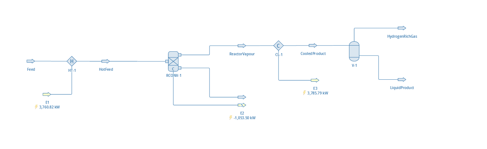
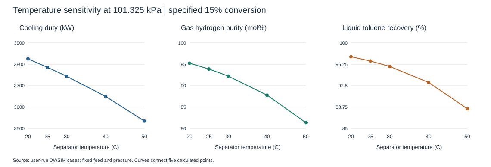

# Toluene Production: DWSIM Simulation and Separation Sensitivity

A guided educational steady-state model of n-heptane conversion to toluene and hydrogen, followed by cooling and gas-liquid separation. Built in DWSIM, not Aspen HYSYS.

## Objective and flowsheet
Evaluate how separation temperature changes hydrogen purity, toluene recovery and cooling duty at fixed feed and conversion.

## Basis
- Pure n-heptane feed: 100 kmol/h at 25 C and 101.325 kPa absolute.
- Reaction: C7H16 -> C7H8 + 4 H2; specified conversion 15%, vapor phase.
- Peng-Robinson property package, following the reference hydrocarbon modelling approach; no experimental property validation performed.
- Heater outlet and isothermal reactor: 426.67 C; zero pressure drops.
- Heater/cooler efficiency settings 100%; base cooler outlet 25 C.
- Separator: Legacy mode, inlet-minimum pressure, no temperature/pressure overrides or heat streams.
- Reactor secondary material outlet (label 5) has zero flow at the base case.

## Reproduce
1. Open `model/Toluene_Production_BaseCase_25C.dwxmz`. Saved object version: DWSIM 10.2.3.0. Different versions may give different results.
2. Solve; confirm cooler outlet 25 C, separator overrides off, and feed 100 kmol/h.
3. Save a separate working copy. Change only CL-1 outlet temperature to 20, 25, 30, 40 and 50 C, solving each case.
4. Record cooling duty, gas/liquid molar flow and component mole fractions. Restore 25 C afterward.

This file stores the base case. Sensitivity runs were manual, not a saved automated sensitivity study. Screenshot results were transcribed and arithmetic-checked; the assistant inspected the saved model without independently rerunning DWSIM.

## Results
| Temperature (C) | Cooling duty (kW) | H2 purity (mol%) | Toluene recovery (%) |
|---|---:|---:|---:|
| 20 | 3825.17 | 95.24 | 97.56 |
| 25 | 3785.79 | 93.89 | 96.82 |
| 30 | 3743.79 | 92.23 | 95.86 |
| 40 | 3649.43 | 87.77 | 93.08 |
| 50 | 3534.69 | 81.37 | 88.45 |

At 25 C, gas hydrogen purity is 93.89 mol%; liquid toluene recovery is 96.82%. Liquid toluene purity is only 15.09 mol%, because most of the liquid is unreacted heptane.

From 20 to 50 C, calculated cooling duty decreases 290.48 kW (7.59%), while hydrogen purity decreases from 95.24 to 81.37 mol% and toluene recovery decreases from 97.56 to 88.45%. This is a thermal-duty versus separation trade-off, not an economic optimum or demonstrated plant energy saving. Cooling duty is not electrical consumption; utility availability and cost have not been evaluated.

## Checks and formulas
Expected reactor outlet: 85 kmol/h heptane, 15 toluene, 60 hydrogen. Total molar flow rises to 160 kmol/h; mass is conserved within numerical tolerance.

All five screenshot cases close each component balance to within 0.001 kmol/h using rounded displayed data.

Base heat inputs: heater 3760.82 kW and reactor 1053.50 kW; cooler removes 3785.79 kW. E2 is negative because it is an outgoing energy stream; reactor DeltaQ is positive. The saved total-energy-flow balance closes within 0.003 kW, including the model's chemical energy reference.

Toluene recovery (%) = liquid molar flow x liquid toluene fraction / 15 x 100.
Hydrogen recovery (%) = gas molar flow x gas hydrogen fraction / 60 x 100.
Purity (mol%) = component mole fraction x 100.

[Detailed verification](results/verification.md) | [Raw results and balance residuals](results/sensitivity.json)

## Limitations
Conversion is prescribed, not predicted from kinetics, catalysts or equilibrium. No equipment sizing, distillation purification, recycle, economics, safety assessment or industrial validation. A flash separator does not produce pure toluene. This is an introductory process-analysis project, not a production-ready plant design.

## Reference and contribution
Starting concept: [Akshay Kumar's Aspen project](https://github.com/itsAkshayKr/Aspen-Project).

Kripanshu Narayan recreated the flowsheet in DWSIM with AI-assisted step-by-step guidance and performed the temperature runs. Documentation and arithmetic checks were AI-assisted. Credit the reference for its original example; this project does not establish hands-on HYSYS experience.
